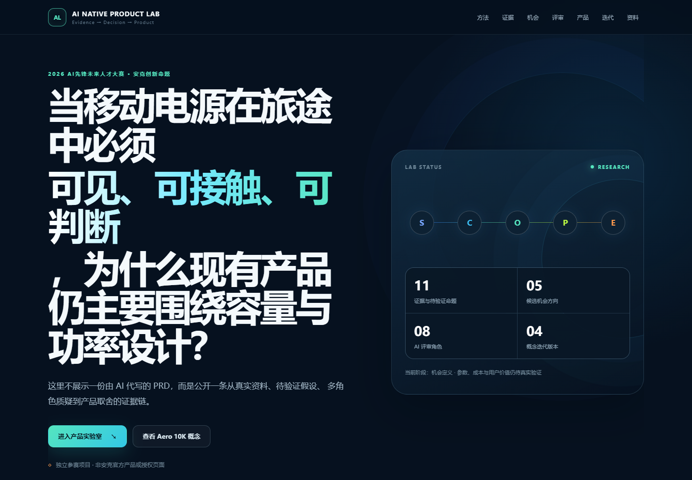
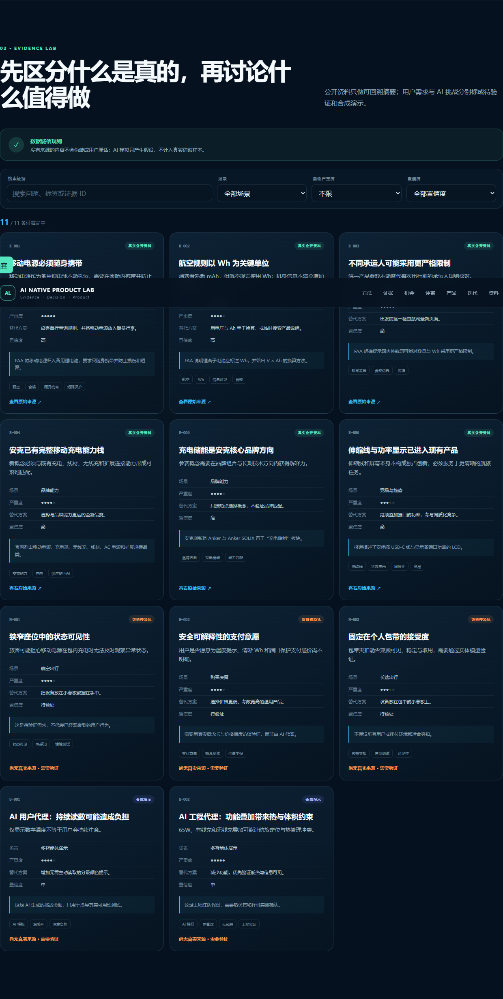
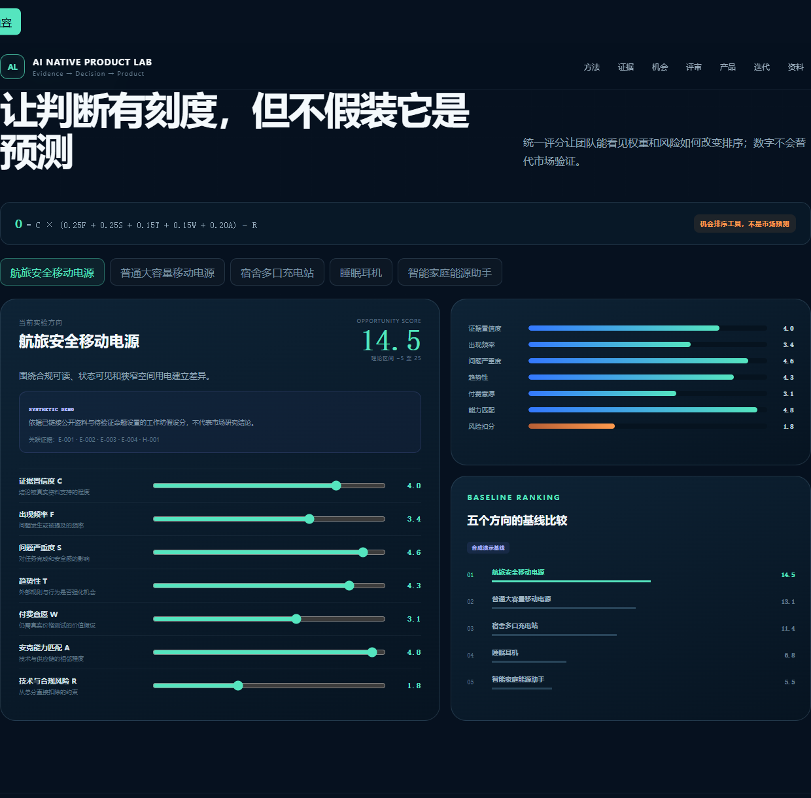
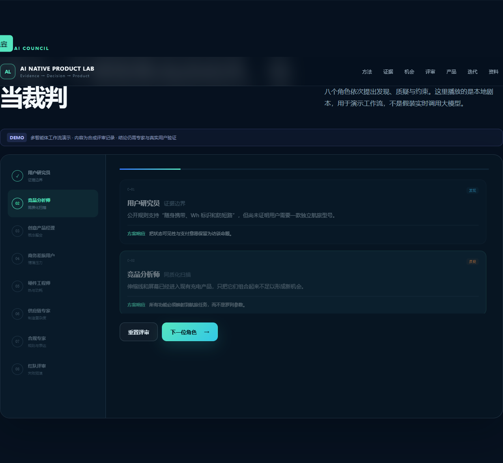
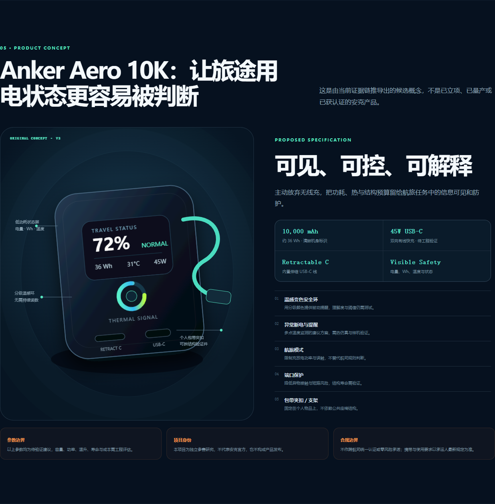
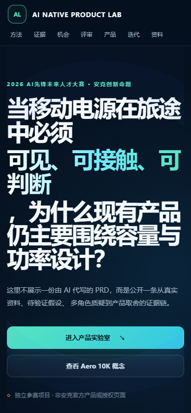

# Anker AI Native Product Lab

> 用真实资料、可见假设、多角色质疑与验证闭环，重新定义一款消费电子产品。

[](https://xiaotian69.github.io/anker-ai-native-product-lab/)
[](https://react.dev/)
[](https://vite.dev/)
[](#数据真实性声明)

[在线体验](https://xiaotian69.github.io/anker-ai-native-product-lab/) · [下载项目 PDF](https://xiaotian69.github.io/anker-ai-native-product-lab/docs/Anker_AI原生产品设计方案_赵子健.pdf) · [研究方法](docs/methodology.md) · [访谈提纲](docs/interview-guide.md)



## 项目背景

这是赵子健参加“2026 AI先锋未来人才大赛——安克创新命题”的独立展示项目。命题不是给现有流程加一个 AI 助手，而是探索：能否把消费电子产品定义变成一个由证据驱动、多角色相互质疑、持续学习且可以追溯的决策系统。

一句话产品概念：

> Anker Aero 10K 是一款面向航空与长途出行的候选移动电源，通过清晰 Wh、低功耗状态屏、温感提示、伸缩线和个人包带夹扣，让旅途用电状态更容易被判断。

以上只是待验证建议，不代表安克已立项、已量产或已认证的产品。

## SCOPE AI 双闭环

| 阶段 | 作用 | 关键产物 |
| --- | --- | --- |
| S · Scan | 扫描并核验真实资料 | 带来源和置信度的证据卡 |
| C · Construct | 聚类问题并统一排序 | 需求图谱、机会评分与敏感性分析 |
| O · Orchestrate | 编排相互独立的 AI 角色 | 分歧、约束和功能—证据映射 |
| P · Prove | 用专家与真实用户验证 | 工程门、合规门和原型任务结果 |
| E · Evolve | 让反馈改变需求和版本 | 可追溯的版本决策链 |

核心判断：传统方法把 AI 当助手；AI 原生方法把产品定义变成持续学习、可追溯的决策系统。

## 可交互实验室

- **Evidence Lab**：搜索并按场景、严重度和置信度筛选证据；公开资料、访谈命题和合成演示使用不同标签。
- **Opportunity Map**：拖动 C/F/S/T/W/A/R 七项指标，实时查看评分和五个产品方向的基线比较。
- **AI Council**：顺序播放八角色本地评审剧本，展示用户、工程、供应链与合规之间的真实冲突。
- **Product Concept**：用原创 SVG/CSS 呈现 Aero 10K 的状态屏、温感环、伸缩线与夹扣概念。
- **Evolution**：把 V0–V3 的问题、证据 ID 和产品修改连成一条决策链。
- **Resources**：下载研究说明、SCOPE 方法、访谈提纲、证据 CSV 和五个角色提示词。

| Evidence Lab | Opportunity Map |
| --- | --- |
|  |  |

| AI Council | Product Concept |
| --- | --- |
|  |  |

移动端已单独验证：



## 机会评分

```text
O = C × (0.25F + 0.25S + 0.15T + 0.15W + 0.20A) - R
```

输入统一使用 0–5 分，公式理论范围为 −5 至 25，输出保留一位小数。五个方向的默认值全部标为 `SYNTHETIC_DEMO`，是用于演示权重与风险如何改变排序的工作坊假设分；没有链接证据的方向不会被解释成研究结论。这个模型不用于预测市场规模、销量、成本或最终立项结果。

## 数据真实性声明

当前站点包含 11 张研究卡：6 张来自可回溯公开网页，3 张明确标注为“访谈待验证”，2 张明确标注为“合成演示”。本项目没有声称已经完成用户访谈，也没有把 AI 用户代理当成真实用户。

- 公开资料附来源 URL 与访问日期 `2026-07-19`。
- 无真实来源的内容不会伪装成用户原话。
- AI Council 是工作流演示，不是实时大模型输出或专家意见。
- 所有容量、功率、热、结构与价格相关结论都需要后续工程或用户验证。
- 航空携带和使用要求以承运人最新规定为准。

详见 [研究说明](docs/research-notes.md) 与 [证据卡 CSV 模板](docs/evidence-template.csv)。

## 技术栈

- React 19 + TypeScript
- Vite 8
- 原生 CSS 与原创 SVG 图形
- Vitest + Testing Library
- GitHub Actions + GitHub Pages
- 纯前端静态数据，不需要 API Key 或服务器

## 本地运行

需要 Node.js 24 和 npm。

```bash
npm install
npm run dev
```

Vite 会在 `/anker-ai-native-product-lab/` 子路径提供开发页面。

## 测试与构建

```bash
npm test -- --run
npm run build
```

测试覆盖评分公式、输入边界、证据组合筛选、Pages 资源路径、数据来源约束和关键交互。生产构建输出到 `dist/`。

## 目录

```text
src/                  React 页面、交互、数据与测试
docs/                 方法、研究记录、访谈提纲与截图
prompts/              五个可复用 AI 角色提示词
public/docs/          网站可下载的 PDF 与研究材料
public/prompts/       网站可下载的提示词
.github/workflows/    测试、构建与 Pages 部署
```

## 下一步真实验证

1. 招募近期有长途出行经历的参与者，先研究最近一次真实行为。
2. 测试 Wh、低功耗屏和温感环在无解释条件下的理解度。
3. 用纸模验证包带夹扣的安装、查看、取用和收纳任务。
4. 用价格阶梯验证整体方案与单项功能的支付意愿。
5. 完成热仿真、线材回卷寿命、结构公差、样机温升与承运人规则复核。

## 项目声明

本仓库是独立参赛研究，不属于安克创新或其关联品牌，不使用安克官方 Logo，也不构成官方产品发布、安全保证或航空许可。`Anker` 名称仅用于说明比赛命题与候选品类。

作者：**赵子健** · GitHub：[@Xiaotian69](https://github.com/Xiaotian69)

代码采用 [MIT License](LICENSE) 发布；PDF、研究文字与原创视觉的署名权归作者所有。
